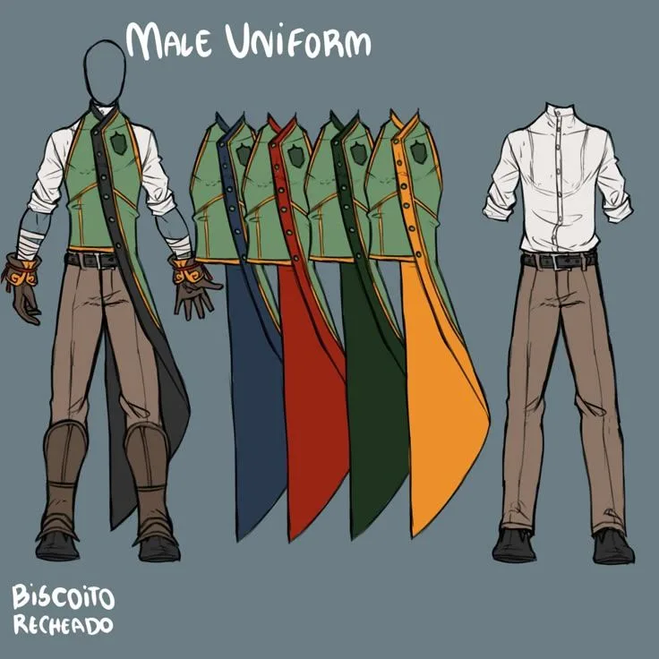
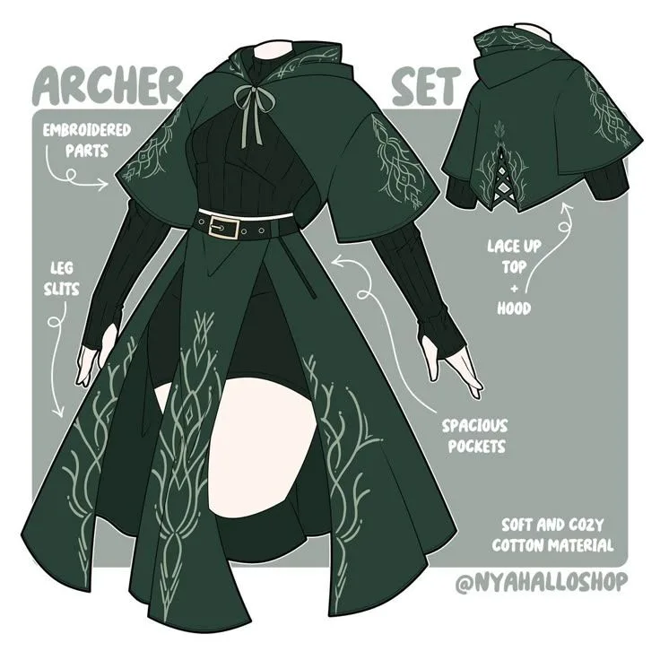

# O que é o Grande Engenho?

O grande engenho é a academia de duelistas localizada numa pequena ilhota perto de Fernando de Noronha onde a campanha Fluxo RPG: Craquelos vai ocorrer.

Nessa academia os estudantes já são bruxos iniciados (ou seja, já tem a formação em uma escola de bruxo/já tem experiência) e vão aprender, praticar e se especializar em diplomacia, geografia, estatística, probabilidade, cálculo, relações internacionais e ,obviamente, duelos.

Todos os anos, a academia recebe cerca de 300 estudantes, que inicialmente são filtrados até sobrarem 75. Todos os anos a filtragem muda, sendo impossível saber qual será o método do ano que estão entrando.

## Mapa

> 
> 
> [https://molinete-magico.github.io/blog/mapas/grande-engenho.html](https://molinete-magico.github.io/blog/mapas/grande-engenho.html)

## Uniformes

Os uniformes do colégio são mais usados em situações mais sérias/celebrações. Dentro do campus, é opcional usar seus uniformes (apesar de ser bem visto você utilizar seu uniforme).  
  
O uniforme tem três variações:

### Masculino

### Feminino

Todos os alunos tem direito a receber uma unidade dos dois uniformes, selecionando previamente se querem os dois, ou apenas um deles.  
Na versão sem colete da roupa masculina, é recomendável que se utilize uma gravata com as cores de sua casa.

Na versão feminina, existe a possibilidade de fechar as fendas do vestido para uma aparência mais modesta.

## Casas

Obviamente, dentro da academia de bruxos, existe uma separação por casas.  
Diferente do comum, os bruxos só são atrelados a casas em academias e não em escolas.

As quatro casasNo Grande Engenho, as quatro casas representam diferentes maneiras de compreender e praticar os duelos. Elas não determinam a personalidade, as habilidades ou o caráter de seus integrantes, mas refletem filosofias que influenciam a cultura e as tradições de cada grupo.**⚔ Espadas**Para Espadas, um duelo exige decisões firmes, iniciativa e disposição para enfrentar o adversário diretamente. Seus integrantes valorizam a execução e a capacidade de sustentar as próprias escolhas sob pressão. Mantêm uma antiga rivalidade com Paus, marcada por provocações, disputas e divergências sobre o que significa ser um bom duelista.**♥ Copas**Copas entende que um duelo também envolve intenções, vínculos e consequências. Seus integrantes valorizam a compreensão do oponente e a capacidade de influenciar o rumo de um confronto. São conhecidos por organizar as festas e celebrações da academia, mantendo viva a vida social entre os estudantes.**◇ Ouros**Para Ouros, vencer significa construir uma posição favorável por meio do planejamento, da administração de recursos e da avaliação de riscos. Seus integrantes procuram transformar oportunidades em vantagens concretas. A casa também possui um sistema próprio de trocas entre estudantes.**♣ Paus**Paus acredita que as possibilidades de um duelo vão além das estratégias convencionais. Seus integrantes valorizam a criatividade, a adaptação e a busca por soluções inesperadas. Essa postura frequentemente entra em conflito com a filosofia de Espadas, cuja preferência pelo confronto direto é alvo constante das provocações de Paus.Pertencer a uma casa não significa seguir sua filosofia perfeitamente. Cada estudante desenvolve seu próprio estilo, e parte de sua formação consiste em descobrir como suas convicções se relacionam com a prática. Nenhuma casa é superior às demais: cada uma oferece diferentes maneiras de compreender o duelo e seus desafios.
