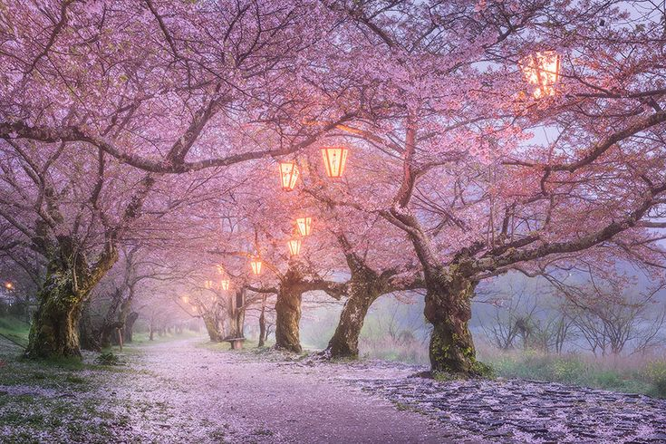
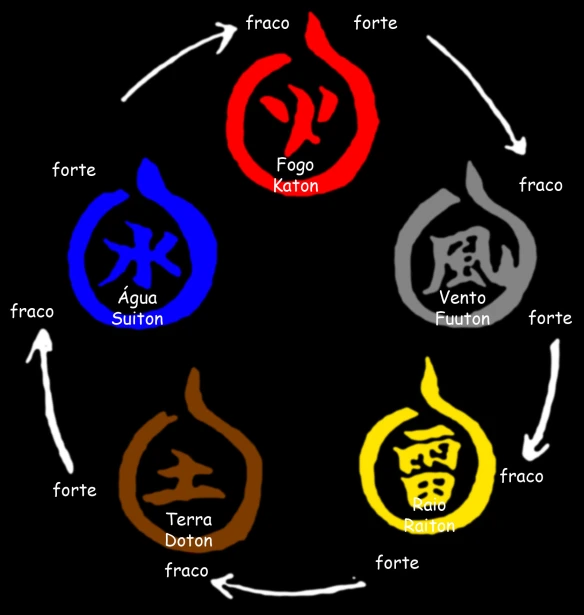

Naruto: Cinzas do Vale é um complemento do SUM focado em contar a história dos genins do vale abençoado.

Todas as regras do SUM base se aplicam aqui, a única adição sendo a troca do nome Estado Mental para Chakra por motivos de imersão.

Nessa versão 0.5 entraremos apenas no que diz respeito aos jogadores e focando em suas builds. Qualquer tipo de alterações que quiserem, podem entrar em contato comigo. Também vou tentar usar uma linguagem de fácil entendimento para que os players pouco acostumados com sistemas possam jogar melhor.

Tenham em mente que apenas estou adaptando o naruto Shinobi no Sho (sistema que estamos usando) dentro do SUM, logicamente vão existir algumas mudanças no jeito de jogar, especialmente da haru, que tem uma ficha muito especializada em jutsus com pouca versatilidade.

## Clãs

- Uchiha: Recebe gratuitamente o Jutsu Bola de Fogo e tem a capacidade de usar o Sharingan (Mais explicações no tópico de Jutsus/Poderes)
- Yamanaka: Tem a possibilidade de usar o controle mental quando o alvo está restringido, preso, dormindo, atordoado, incapacitado ou morrendo (Mais detalhes no tópico de Jutsus/Poderes).
- ______ (clã do natsu): + 10 pontos de chakra e o poder Vigoroso

## Aptidões

Se quiserem continuar com as aptidões que já tem, tudo bem. Mas agora, podemos ter aptidões homebrew (feitos por nós).

As aptidões são talentos/aprendizados do seu personagem que não são ativos. Por exemplo, uma aptidão que existe na ficha antiga da haru é a fascinar, ela dá a capacidade de (por uma certa DT calculada pela ficha) fascinar um oponente.

Algumas ideias de aptidões para caso queiram renovar suas fichas:

- Poder utilizar mais um jutsu com chakra zerado.
- Conseguir se esconder melhor à noite.
- Saber ler línguas antigas.
- Utilizar técnicas médicas/Curar (boa natsu)

As aptidões realmente simbolizam sistematicamente o que seu personagem pode fazer que o diferencia dos outros.

**É possível ter 3 aptidões no estado atual da história**

Vocês também podem sacrificar uma aptidão para ganhar um poder (obrigatoriamente precisam de no mínimo uma aptidão).

## Poderes/Jutsus

### Poderes
Os poderes são movimentos ou capacidades que um personagem pode ter, desde taijutsu (estilo de luta voltado para o corpo a corpo) até selos (ss arhtur, vc vai ganhar um buff com essa troca de sistema).

Vocês podem criar qualquer tipo de movimento de Taijutsu ou selo que seja condizente com o nível atual de vocês (não vai poder criar um desvio e te mato). Caso queiram continuar com os que já existem vamos apenas rebalancear os mesmos.

### Jutsus

Aqui seguimos a mesma lógica dos poderes, é possível criar alguns a partir de suas ideias, porém, agora com bem mais liberdade.

Lembre-se que, para utilizar jutsus elementais, é necessário ter a aptidão daquele elemento, ou seja, para ter um jutsu de água, precisaremos da aptidão Suiton.

*Obs: As fraquezas são aplicadas aqui, ou seja, se o utilizar bola de fogo em um personagem que está diretamente utilizando um jutsu de suiton como defesa, a bola de fogo é anulada.*

### Poderes/Jutsus citados no sistema

- Sharingan: Permite um bônus de +1 em rolagens referentes a leitura de inimigos e permite desviar de ataques inimigos utilizando controle (teste de Controle + Reflexos).
- Jutsu Bola de Fogo: Uma bola de fogo em um cone de até 8 metros. 4 de dano em contato direto (resistência é vigor e reduz o dano para 2), aplica o efeito **queimando**.
- Controle mental Yamanaka: Permite que o alvo seja controlado pelo Yamanaka capaz de utiilizar esse jutsu. É necessário o alvo estar restringido, preso, dormindo, atordoado, incapacitado, morrendo ou qualquer outra condição incapacitante. É necessário realizar um teste de resistência contra o alvo para dominar(Controle + 2 para quem utilizou o Jutsu e Mental - 1 para o alvo).
- Vigoroso: Permite (uma vez por cena) retirar um efeito/condição de sí mesmo.

## Equipamentos

Vai ser uma sessão bem curta, apenas definindo os equipamentos que vocês podem usar.

- Kunai: 2 de dano base. Pode ser arremessada com destreza ou usada como arma corpo a corpo.
- Shuriken: 1 de dano base. Pode ser arremessada com destreza. Podem ser arremessadas até no máximo 3. (Limite de 10 por inventário).
- Bomba de fumaça: Gera um círculo de 5 metros de diametro onde só é possível ver até 2 metros a frente. Quem está de fora não consegue enxergar o outro lado. Fica ativa por 1 rodada.
- Tarja de explosão: Explode quando ativada por um pequeno fluxo de chakra ou por pressão. 8 de dano para quem está até 8 metros da explosão e 4 para quem está até 12. Teste de resistência com vigor reduz pela metade.
